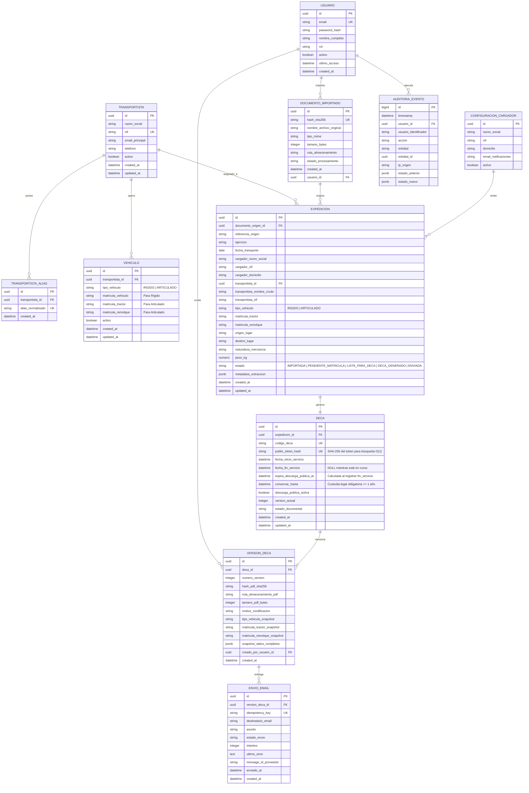

# DECA LIGHT — MODELO DE DATOS Y PERSISTENCIA (CONSOLIDADO)
**Proyecto:** DECA Light  
**Empresa:** Tomates de Autor S.L.  
**Versión:** 1.5 (Revisión y Consolidación)  
**Fecha:** 03/10/2026  
**Estado:** Especificación de Persistencia Aprobada

---

## 1. DIAGRAMA ENTIDAD-RELACIÓN CONSOLIDADO



---

## 2. ESPECIFICACIÓN DE ENTIDADES ACTUALIZADAS

### 2.1. Entidad: `Vehiculo` (Tipificación Rigurosa Rígido vs. Articulado)
- **Propósito:** Almacena combinaciones de vehículos homologados asegurando que no se mezcle la casuística de camiones rígidos con conjuntos articulados.
- **Campos:**
  - `id`: `UUID` (PK).
  - `transportista_id`: `UUID` (FK -> `transportista.id`).
  - `tipo_vehiculo`: `VARCHAR(20)` NOT NULL. Valores: `'RIGIDO'`, `'ARTICULADO'`.
  - `matricula_vehiculo`: `VARCHAR(20)` NULLABLE. (Solo para vehículos rígidos).
  - `matricula_tractor`: `VARCHAR(20)` NULLABLE. (Solo para conjuntos articulados).
  - `matricula_remolque`: `VARCHAR(20)` NULLABLE. (Solo para conjuntos articulados).
  - `activo`: `BOOLEAN` NOT NULL DEFAULT true.
  - `created_at`: `TIMESTAMP WITH TIME ZONE` NOT NULL.
  - `updated_at`: `TIMESTAMP WITH TIME ZONE` NOT NULL.
- **Invariantes y Restricciones a Nivel de Base de Datos:**
  ```sql
  CONSTRAINT check_tipo_vehiculo_valido CHECK (
      (tipo_vehiculo = 'RIGIDO' AND matricula_vehiculo IS NOT NULL AND matricula_remolque IS NULL) OR
      (tipo_vehiculo = 'ARTICULADO' AND matricula_tractor IS NOT NULL AND matricula_remolque IS NOT NULL)
  )
  ```

---

### 2.2. Entidad: `Expedicion` (Estados y Flujo Operativo Real)
- **Propósito:** Representa la orden de transporte expedida desde el albarán/carta de porte de Hispatec.
- **Flujo de Estados:**
  - `IMPORTADA`: Documento subido y texto extraído.
  - `PENDIENTE_MATRICULA`: Estado estándar tras importar. Los datos de la carga están completos pero falta asignar la matrícula en muelle.
  - `PENDIENTE_REVISION`: Si el documento no pudo ser parseado con total confianza.
  - `LISTA_PARA_DECA`: Matrícula asignada y validada por `DeCAValidator`.
  - `DECA_GENERADO`: Documento administrativo generado y firmado con su QR y URL.
  - `ENVIADA`: Correo entregado con éxito al transportista.
  - `ERROR`: Fallo irrecuperable o de validación.
  - `CANCELADA`: Transporte suspendido o anulado.
- **Campos de Vehículo en la Expedición:**
  - `tipo_vehiculo`: `VARCHAR(20)` NULLABLE (`'RIGIDO'` o `'ARTICULADO'`).
  - `matricula_tractor`: `VARCHAR(20)` NULLABLE.
  - `matricula_remolque`: `VARCHAR(20)` NULLABLE.
- **Regla de Importación:** La matrícula **NO es obligatoria** durante la importación inicial.

---

### 2.3. Entidad: `DeCA` (Vigencia Determinista y Custodia Legal)
- **Propósito:** Registro del documento administrativo legal y control del acceso público para inspección oficial.
- **Campos:**
  - `id`: `UUID` (PK).
  - `expedicion_id`: `UUID` NOT NULL UNIQUE (FK -> `expedicion.id`).
  - `codigo_deca`: `VARCHAR(50)` NOT NULL UNIQUE (ej: `DECA-2026-000125`).
  - `token_acceso_publico`: `VARCHAR(64)` NOT NULL UNIQUE (Token CSPRNG url-safe de 256 bits).
  - `fecha_inicio_servicio`: `TIMESTAMP WITH TIME ZONE` NOT NULL (Momento formal de expedición previo al inicio efectivo).
  - `fecha_fin_servicio`: `TIMESTAMP WITH TIME ZONE` NULLABLE (Permanece `NULL` mientras el transporte esté en tránsito; no se admiten estimaciones).
  - `expira_descarga_publica_at`: `TIMESTAMP WITH TIME ZONE` NULLABLE.
    - Regla de cálculo determinista: Cuando el usuario o sistema registre `fecha_fin_servicio`:
      $$\text{expira\_descarga\_publica\_at} = \text{fecha\_fin\_servicio} + \text{INTERVAL '7 days'}$$
  - `conservar_hasta`: `TIMESTAMP WITH TIME ZONE` NOT NULL.
    - Regla de custodia legal obligatoria:
      $$\text{conservar\_hasta} = \text{fecha\_inicio\_servicio} + \text{INTERVAL '1 year'}$$
  - `descarga_publica_activa`: `BOOLEAN` NOT NULL DEFAULT true.
  - `version_actual`: `INTEGER` NOT NULL DEFAULT 1.
  - `estado_documental`: `VARCHAR(30)` NOT NULL DEFAULT `'ISSUED'`.

---

### 2.4. Entidad: `VersionDeCA` y Modelo `DeCAEstructurado` (Inmutabilidad Estricta Fase 5)
- **Propósito:** Garantizar que cada generación física en PDF sea inmutable, auditable y desacoplada de la entidad mutable `Expedition`.
- **Modelo de Dominio: `DeCAEstructurado`** (Frozen Dataclass):
  - Representa el conjunto consolidado de datos legales exigidos por la Orden FOM/2861/2012 antes de su renderizado.
  - Provee `to_snapshot()` y `from_snapshot(snapshot_data, snapshot_hash)`.
- **Estructura Canónica del `snapshot_data` (JSONB):**
  ```json
  {
    "deca_code": "DECA-2026-000001",
    "version": 1,
    "expedition_id": "uuid-expedicion",
    "internal_id": "TD-2026-00001",
    "external_reference": "ALB-2026-9999",
    "fiscal_year": "2026",
    "issue_datetime": "2026-10-15T08:30:00+00:00",
    "transport_date": "2026-10-15",
    "shipper": {
      "name": "Tomates de Autor S.L.",
      "tax_id": "B12345678",
      "address": "Polígono La Redonda, Almería"
    },
    "carrier": {
      "name": "Transportes del Poniente S.L.",
      "tax_id": "B04999888",
      "email": "trafico@poniente.com"
    },
    "vehicle": {
      "type": "ARTICULADO",
      "tractor_plate": "1234BCD",
      "trailer_plate": "R5678EFG"
    },
    "route_and_goods": {
      "origin": "El Ejido (Almería)",
      "destination": "Mercamadrid (Madrid)",
      "goods": "Tomate Rama Extra",
      "weight_kg": 18500.0
    },
    "observations": "Conservar entre 10 y 12 grados"
  }
  ```
- **Campos de Persistencia de la Versión:**
  - `id`: `UUID` (PK).
  - `deca_id`: `UUID` NOT NULL (FK -> `deca.id`).
  - `numero_version`: `INTEGER` NOT NULL DEFAULT 1.
  - `hash_pdf_sha256`: `CHAR(64)` NOT NULL (Huella criptográfica del binario físico generado).
  - `snapshot_hash`: `CHAR(64)` NOT NULL (SHA-256 del JSON canónico ordenado de datos).
  - `ruta_almacenamiento_pdf`: `VARCHAR(500)` NOT NULL (`deca/YYYY/DECA-YYYY-NNNNNN.pdf`).
  - `tamano_pdf_bytes`: `INTEGER` NOT NULL ($\le 300\text{ KB}$, típicamente $\sim 5\text{ KB}$).
  - `motivo_modificacion`: `VARCHAR(255)` NULLABLE (Solo requerido a partir de versión 2 en adelante).
  - `snapshot_data`: `JSONB` NOT NULL (Copia inmutable aislada por serialización defensiva).
  - `created_at`: `TIMESTAMP WITH TIME ZONE` NOT NULL.
- **Invariante de Inmutabilidad:** `DeCA.add_version()` lanza `ImmutableDeCAException` si se intenta sobreescribir una versión ya emitida. Cualquier mutación posterior en `Expedition` no altera el `snapshot_data` ni el binario PDF.

---

### 2.5. Entidad: `EnvioEmail` (`EmailDelivery` — Fase 7)
- **Propósito:** Registro custodial, transaccional e idempotente de las transmisiones de documentos DeCA por correo electrónico al transportista.
- **Campos de Persistencia:**
  - `id`: `UUID` (PK).
  - `expedition_id`: `UUID` NOT NULL (FK -> `expedicion.id`).
  - `deca_id`: `UUID` NOT NULL (FK -> `deca.id`).
  - `deca_code`: `VARCHAR(50)` NOT NULL (ej: `DECA-2026-000101`).
  - `deca_version`: `INTEGER` NOT NULL DEFAULT 1.
  - `recipient_email`: `VARCHAR(254)` NOT NULL (Validado por VO `EmailAddress` RFC 5322 y normalizado a minúsculas).
  - `subject`: `VARCHAR(250)` NOT NULL (Formato: `DECA – Expedición {internal_id} – [{destination}]`).
  - `idempotency_key`: `CHAR(64)` NOT NULL UNIQUE (Índice único criptográfico).
    - Modo automático: `SHA-256("AUTO:{deca_id}:{version}:{recipient}:{pdf_sha256}")`
    - Modo reenvío manual: `SHA-256("MANUAL_RESEND:{deca_id}:{version}:{recipient}:{pdf_sha256}:{iso_timestamp}")`
  - `status`: `VARCHAR(30)` NOT NULL DEFAULT `'EMAIL_PENDING'`.
    - Estados: `EMAIL_PENDING`, `EMAIL_SENDING`, `EMAIL_SENT`, `EMAIL_FAILED`, `EMAIL_RETRY_PENDING`.
  - `attempts`: `INTEGER` NOT NULL DEFAULT 0.
  - `provider`: `VARCHAR(30)` NOT NULL DEFAULT `'graph'`.
  - `message_id`: `VARCHAR(255)` NULLABLE (Identificador asignado por Microsoft Graph API o cabecera `client-request-id`).
  - `last_error`: `TEXT` NULLABLE (Descripción sanitizada sin filtrar credenciales ni tokens).
  - `is_resend`: `BOOLEAN` NOT NULL DEFAULT false.
  - `created_at`: `TIMESTAMP WITH TIME ZONE` NOT NULL.
  - `sent_at`: `TIMESTAMP WITH TIME ZONE` NULLABLE (Momento exacto de confirmación HTTP 202).
- **Invariantes de Dominio y Seguridad:**
  1. **Idempotencia Estricta:** La unicidad de `idempotency_key` previene el doble envío por pulsaciones repetidas o reintentos simultáneos.
  2. **Verificación Previa de Integridad:** Se comprueba `SHA-256(pdf_bytes) == version.pdf_sha256` antes de llamar al emisor.
  3. **Desacoplamiento de Fallo:** Los fallos transitorios (`EMAIL_RETRY_PENDING`) o permanentes (`EMAIL_FAILED`) nunca invalidan el `DeCA` emitido ni la versión custodial.
  4. **Privacidad RGPD:** En logs y auditoría, el destinatario se almacena y expone ofuscado (`recipient_masked` = `lo***@domain.com`).

---

### 2.6. Entidad: `Empresa` (`Company` / Multiempresa — Prompt 7.5)
- **Propósito:** Definición del contexto societario emisor para el soporte concurrente de **Tomates de Autor S.L.** y **Cultivos Araba S.L.**
- **Campos de Persistencia / Configuración:**
  - `company_id`: `VARCHAR(50)` (PK / Identificador canónico en mayúsculas, ej: `TOMATES_DE_AUTOR`, `CULTIVOS_ARABA`).
  - `legal_name`: `VARCHAR(255)` NOT NULL (Razón social oficial de la sociedad).
  - `tax_id`: `NIF` NULLABLE (NIF/CIF validado. Nulo si está pendiente de configuración legal).
  - `fiscal_address`: `VARCHAR(255)` NOT NULL DEFAULT `""` (Domicilio fiscal completo).
  - `document_aliases`: `TEXT[]` (Tupla de denominaciones comerciales secundarias y variantes documentales para matching).
  - `active`: `BOOLEAN` NOT NULL DEFAULT `true`.
  - `created_at`: `TIMESTAMP WITH TIME ZONE` NOT NULL.
  - `updated_at`: `TIMESTAMP WITH TIME ZONE` NOT NULL.
- **Propiedades Derivadas:**
  - `is_fully_configured`: `bool` — `True` solo si cuenta con `tax_id` y `fiscal_address` válidos.
  - `pending_fields`: `tuple[str, ...]` — Lista de campos fiscales requeridos ausentes (ej: `("tax_id", "fiscal_address")` para `CULTIVOS_ARABA`).
- **Atributo `company_id` en Entidades Existentes:**
  - `EXPEDICION.company_id`: `VARCHAR(50)` NOT NULL (Invariante: no puede pasar a `LISTA_PARA_DECA` sin valor).
  - `DECA.company_id`: `VARCHAR(50)` NOT NULL (Refleja la sociedad emisora del documento legal).
  - `DECA_ESTRUCTURADO.company_id`: `VARCHAR(50)` NOT NULL (Incluido en el snapshot canónico inmutable y su hash).
  - `ENVIO_EMAIL.company_id`: `VARCHAR(50)` NOT NULL (Trazabilidad societaria en la entrega al transportista).
  - `AUDITORIA_EVENTO.company_id`: `VARCHAR(50)` NULLABLE (Permite segmentar pistas de auditoría por sociedad).


