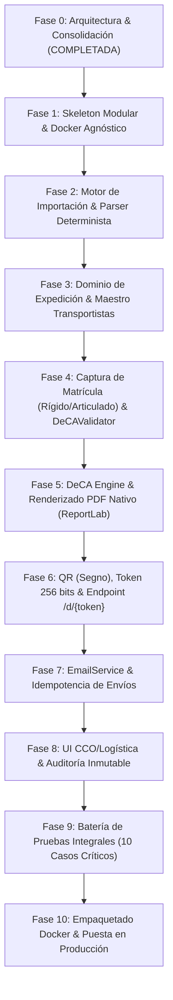

# DECA LIGHT — ROADMAP DE IMPLEMENTACIÓN PRAGMÁTICA (CONSOLIDADO)
**Proyecto:** DECA Light  
**Empresa:** Tomates de Autor S.L.  
**Versión:** 1.5  
**Fecha:** 03/10/2026  
**Estado:** Plan Operativo Consolidado

---

## 1. PRINCIPIO DE EJECUCIÓN DEL MVP

El MVP de DECA Light está estrictamente delimitado para resolver de forma impecable el flujo nuclear de Tomates de Autor S.L. con mínima intervención manual:

$$\mathbf{PDF\ Hispatec} \longrightarrow \mathbf{Expedici\acute{o}n\ (Pendiente\ Matr\acute{\imath}cula)} \longrightarrow \mathbf{Matr\acute{\imath}cula} \longrightarrow \mathbf{Validaci\acute{o}n} \longrightarrow \mathbf{DeCA\ PDF} \longrightarrow \mathbf{QR\ /\ URL} \longrightarrow \mathbf{Email} \longrightarrow \mathbf{Auditor\acute{\imath}a}$$

---

## 2. FASES DE DESARROLLO (FASES 0 A 10)

---

### Fase 0: Arquitectura, Revisión y Consolidación
- **Objetivo:** Especificación rigurosa, resolución de contradicciones, decoupling total de infraestructura y formalización de ADRs.
- **Entregables:** Documentación completa actualizada (`ARCHITECTURE.md`, `DATA_MODEL.md`, `SECURITY.md`, `ROADMAP.md`, `TECH_DECISIONS.md`, `RISKS.md`).
- **Estado:** ✅ Completada.

---

### Fase 1: Skeleton Modular & Docker Agnóstico
- **Objetivo:** Estructurar el proyecto en 4 capas limpias (`domain`, `application`, `infrastructure`, `presentation`), configuración por variables de entorno y contenedor Docker genérico.
- **Entregables:**
  - Configuración Python 3.12 (`pyproject.toml`).
  - Base de datos relacional SQLAlchemy 2.0 (PostgreSQL / SQLite).
  - Healthcheck (`/healthz`) y configuración de logging estructurado.
- **DoD:** Contenedor Docker arranca en local y la suite de pytest ejecuta pruebas en verde.
- **Estado:** ✅ Completada.

---

### Fase 2: Motor de Importación & Parser Multiformato (Carta de Porte + CMR)
- **Objetivo:** Implementar `DocumentParserPort`, `CartaDePorteParser`, `CMRParser` y `CompositeDocumentParser` sin IA.
- **Entregables:**
  - Extracción determinista de capas de texto con `pypdf`/`pdfplumber`.
  - Normalización de pesos, fechas y NIFs a `NormalizedDocumentDTO` con trazabilidad `ExtractedField`.
  - Detección de duplicados mediante hash SHA-256 del fichero original.
  - Endpoint de importación por lotes `POST /api/v1/documents/import-batch`.
- **DoD:** Documentos reales de Carta de Porte y CMR auditados y procesados en verde.
- **Estado:** ✅ Completada (Auditada en Prompt 03.5).

---

### Fase 3: Dominio de Expedición & Identificador Visible TD-YYYY-NNNNN
- **Objetivo:** Implementar la entidad `Expedition`, ciclo de vida con estados operativos y generación atómica de identificadores visibles para el operador de muelle.
- **Entregables:**
  - Generador concurrente y atómico de identificadores `TD-YYYY-NNNNN`.
  - Trazabilidad y auditoría de creación de expedición.
  - Transición a `PENDIENTE_MATRICULA` con transportista y matrículas ausentes.
- **DoD:** Expediciones importadas numeradas secuencialmente sin colisiones ni huecos.
- **Estado:** ✅ Completada.

---

### Fase 4: Captura de Matrícula (Rígido vs. Articulado) & Validador Legal DeCA (PROMPT 04)
- **Objetivo:** Captura y normalización estricta de vehículos, transportistas en muelle y validación exhaustiva con `DeCAValidator`.
- **Entregables:**
  - Tipificación estricta de vehículo:
    - **Rígido:** Matrícula obligatoria, remolque prohibido.
    - **Articulado:** Matrícula de tractor obligatoria Y matrícula de semirremolque/remolque obligatoria.
  - Normalizador determinista de matrículas (`VehicleRegistrationNormalizer`) para matrículas nacionales y extranjeras.
  - Servicio de dominio puro `DeCAValidator` que comprueba todos los requisitos de la Orden FOM/2861/2012 y distingue errores bloqueantes de warnings no bloqueantes.
  - Caso de uso operativo `AssignVehicleToExpeditionUseCase` con idempotencia y auditoría inmutable (`VEHICLE_ASSIGNED`, `VEHICLE_UPDATED`, `CARRIER_ASSIGNED`, `VALIDATION_EXECUTED`, `EXPEDITION_READY_FOR_DECA`, `VALIDATION_FAILED`).
  - Endpoints REST: `PATCH /api/v1/expeditions/{id}/vehicle`, `GET /api/v1/expeditions/{id}/validation`, `GET /api/v1/expeditions/{id}`.
  - Batería de 20 tests unitarios y de integración de Prompt 04 superada con 91% de cobertura.
- **DoD:** Bloqueo explícito si falta un dato legal o la combinación es inválida; avance a `LISTA_PARA_DECA` si la validación es satisfactoria.
- **Estado:** ✅ Completada.

---

### Fase 5: DeCA Engine & Renderizado PDF Nativo (PROMPT 05)
- **Objetivo:** Motor de negocio desacoplado (`DeCAEstructurado`), snapshot canónico inmutable y renderizado PDF nativo con `ReportLab`.
- **Entregables:**
  - Servicio de dominio `DeCAEngine`: evalúa `LISTA_PARA_DECA`, revalida con `DeCAValidator`, construye `DeCAEstructurado` y genera el snapshot canónico inmutable con hash SHA-256.
  - Modelo `DeCAEstructurado`: frozen dataclass completamente desacoplada de la entidad mutable `Expedition`.
  - Entidad `DeCA` y `DeCAVersion`: inmutabilidad estricta (rechazo de sobreescritura de v1 vía `ImmutableDeCAException`, deep copy defensivo de `snapshot_data`).
  - Renderizador vectorial `ReportLabPdfRenderer`: diseño sobrio fintech/SaaS en A4, tipografía nativa Helvetica seleccionable, soporte inteligente para vehículos rígidos ("No aplica") y articulados (ambas matrículas), espacio reservado para QR (Fase 6), metadatos PDF legales y pie de página con huella criptográfica SHA-256.
  - Adaptador de almacenamiento `LocalPdfStorage`: custodia física determinista en `storage/deca/{fiscal_year}/{deca_code}.pdf` con bloqueo estricto de path traversal.
  - Caso de uso `EmitDeCAUseCase`: sincronización thread-safe, idempotencia garantizada, trazabilidad de auditoría append-only (`DECA_EMISSION_STARTED`, `DECA_EMITTED`, `DECA_EMISSION_FAILED`) y transición de `Expedition` a `DECA_GENERADO`.
  - Endpoints REST: `POST /api/v1/expeditions/{id}/deca`, `GET /api/v1/expeditions/{id}/deca`, `GET /api/v1/deca/{code}/pdf`.
  - Métricas de rendimiento obtenidas: PDF de 5.14 KB generado en 6.68 ms (objetivos: < 300 KB y < 200 ms).
  - Batería de 36 nuevos tests (27 unitarios con 5 casos realistas + 9 de integración API + prueba de regresión de inmutabilidad) elevando el total a 97 tests con 91% de cobertura.
- **DoD:** Generación reproducible de PDF conforme a la Orden FOM/2861/2012 y la Ley 15/2009 en < 10 ms con snapshot inmutable verificado.
- **Estado:** ✅ Completada.

---

### Fase 6: Código QR, Token Criptográfico & Endpoint Público
- **Objetivo:** Habilitar el acceso directo de inspección para carretera con seguridad anti-IDOR y expiración temporal.
- **Entregables:**
  - Token criptográfico de alta entropía $\ge 256$ bits (`secrets.token_urlsafe(32)`), garantizando unicidad y resistencia a ataques de fuerza bruta.
  - Almacenamiento seguro por hash SHA-256 (`public_token_hash`) para indexación y búsqueda $O(1)$ sin almacenar secretos en claro en base de datos.
  - QR 100% vectorial nativo generado con `segno` incrustado directamente en el lienzo de ReportLab (cero imágenes rasterizadas, $< 5\text{ ms}$, tamaño de 72 pt con quiet zone).
  - Estrategia A de emisión: el QR con la URL pública se inserta en el PDF antes de calcular la huella SHA-256 definitiva de custodia.
  - Endpoint público `GET /d/{token}` sin autenticación, con visualización directa `Content-Disposition: inline` para navegadores móviles de agentes de tráfico.
  - Protección estricta anti-IDOR y anti-enumeración: respuesta uniforme `404 Not Found` para tokens inválidos, expirados o inexistentes sin filtración de información.
  - Control de vigencia temporal determinista mediante el servicio `Clock`: acceso ilimitado durante el porte y caducidad estricta a los 7 días naturales tras `fecha_fin_servicio`.
  - Cabeceras de seguridad preventiva: `Cache-Control: private, no-cache, no-store, must-revalidate`, `X-Content-Type-Options: nosniff`, `X-Robots-Tag: noindex, nofollow, noarchive`.
  - Observabilidad y auditoría completa: eventos `PUBLIC_DECA_ACCESS_SUCCESS`, `PUBLIC_DECA_ACCESS_NOT_FOUND`, `PUBLIC_DECA_ACCESS_EXPIRED` con enmascaramiento estricto (`token[:6]...token[-4:]`) y captura de IP de cliente.
  - Batería completa de 39 nuevos tests (12 unitarios + 27 de integración y confirmación end-to-end según Sección 23) elevando la suite a 136 tests con 91% de cobertura global.
- **DoD:** Escaneo de QR físico con móvil descarga el PDF directamente en $< 1\text{ s}$ sin exponer IDs internos ni tokens en texto plano.
- **Estado:** ✅ Completada.

---

### Fase 7: Servicio de Correo (Microsoft Graph API M365) & Idempotencia de Envíos
- **Objetivo:** Entrega automática al transportista sin riesgo de duplicidad ni fugas de seguridad mediante Microsoft Graph API v1.0.
- **Entregables:**
  - Value Object `EmailAddress` con validación sintáctica estricta RFC 5322 y ofuscación de privacidad para observabilidad (`masked`).
  - Entidad de dominio `EmailDelivery` con ciclo de vida explícito (`EMAIL_PENDING`, `EMAIL_SENDING`, `EMAIL_SENT`, `EMAIL_FAILED`, `EMAIL_RETRY_PENDING`).
  - Puerto desacoplado `EmailSenderPort` y adaptador offline `FakeMicrosoftGraphEmailSender` con simulación configurable de HTTP 202, 400, 401, 403, 404, 429, 500 y timeouts.
  - Adaptador de infraestructura `MicrosoftGraphEmailSender` con flujo OAuth 2.0 Client Credentials de Azure Entra ID, caché de access tokens y reintentos automáticos ante errores transitorios.
  - Caso de uso `SendDeCAEmailUseCase`:
    - Comprobación criptográfica obligatoria de integridad del PDF en almacenamiento antes de la transmisión (`SHA-256(pdf_bytes) == version.pdf_sha256`); aborta con `PDF_INTEGRITY_ERROR` y cero llamadas ante discrepancias.
    - Cálculo determinista de clave de idempotencia única: `SHA-256(AUTO:deca_id:version:recipient:pdf_sha256)`.
    - Bloqueo de reenvíos automáticos no solicitados; soporte para reenvío manual explícito (`force_resend=True`) con clave diferenciada y auditoría específica `EMAIL_RESEND_REQUESTED`.
    - Transición de la expedición a `ENVIADA` únicamente si la entrega resulta confirmada.
    - Inmutabilidad estricta del DeCA: los fallos de red o del proveedor de correo nunca invalidan ni modifican el documento DeCA ya emitido.
  - Endpoints REST en FastAPI:
    - `POST /api/v1/expeditions/{id}/deca/email`: envía o reenvía el DeCA garantizando que el destinatario proviene exclusivamente de la expedición (previene inyección de emails arbitrarios).
    - `GET /api/v1/expeditions/{id}/deca/email`: consulta de estado de entrega y trazabilidad histórica con direcciones enmascaradas.
  - Documentación técnica `MICROSOFT_GRAPH_SETUP.md` con aprovisionamiento en Azure Entra ID, permisos de aplicación `Mail.Send` y directiva Exchange `ApplicationAccessPolicy`.
  - Batería de 36 nuevos tests (26 unitarios + 10 de integración) alcanzando 172 tests totales (100% pasando) y 91% de cobertura de código.
- **DoD:** Envío transaccional reproducible mediante Microsoft Graph con verificación de integridad de adjuntos, protección matemática contra duplicados y privacidad de datos.
- **Estado:** ✅ Completada.

---

### Fase 7.5: Multiempresa, Tenant Isolation & Company Context (Prompt 7.5)
- **Objetivo:** Preparar la arquitectura de DECA Light para operar concurrentemente con dos sociedades mercantiles del mismo grupo (**Tomates de Autor S.L.** y **Cultivos Araba S.L.**) compartiendo infraestructura, parsers y buzón unificado sin contaminación cruzada.
- **Entregables:**
  - Entidad `Company` en dominio con validación de completitud fiscal (`is_fully_configured`, `pending_fields`) sin inventar datos fiscales ausentes.
  - Servicio de dominio `CompanyDetector` con cascada determinista: NIF/CIF (1.0), razón social legal (0.95), alias documentales (0.85). Ambigüedad o empresa desconocida deriva limpiamente a `PENDIENTE_REVISION`.
  - Inyección de `company_id` en entidades `Expedition`, `DeCA`, `DeCAEstructurado`, `AuditEvent`, y `EmailDelivery`.
  - Invariante de Dominio: bloqueo estricto de transiciones a `LISTA_PARA_DECA`, `DECA_GENERADO` o `ENVIADA` si la expedición no tiene asignada una sociedad emisora.
  - Aislamiento en deduplicación: claves compuestas de negocio con prefijo de empresa (`{company_id}:CMR:...`, `{company_id}:CP_CARGO:...`).
  - Renderizado dinámico de PDF y snapshots inmutables con la identidad corporativa de la sociedad emisora.
  - Envío de correos desde buzón corporativo unificado e inmutable `pedidos@tomatesdeautor.com`, con firma dinámica en el cuerpo (`Atentamente,\n{empresa.razon_social}`).
  - Control de acceso y protección IDOR en API operativa mediante cabecera `X-Company-Id` (403 Forbidden y auditoría de intentos no autorizados).
  - Acceso público `/d/{token}` agnóstico de empresa para inspecciones oficiales en carretera.
  - Nueva batería de pruebas exhaustiva (`test_company_and_multi_tenant.py`) alcanzando 191 tests totales (100% pasando) y 91% de cobertura global.
- **DoD:** Operación simultánea de Tomates de Autor y Cultivos Araba sin colisiones, con aislamiento de auditoría y buzón seguro.
- **Estado:** ✅ Completada.

---

### Fase 8: Interfaz Visual CCO/Logística & Auditoría Inmutable
- **Objetivo:** UI operativa de alta densidad (Stripe/Linear) y trazabilidad legal inmutable.
- **Entregables:**
  - Pantalla única operativa de expediciones con estados por badges.
  - Atajos de teclado para flujo continuo en almacén.
  - Registro *append-only* en `AuditoriaEvento`.
- **DoD:** Auditoría inmutable sin permisos de UPDATE ni DELETE en base de datos.

---

### Fase 9: Batería de Pruebas Integrales (10 Casos Críticos)
- **Objetivo:** Cobertura de los escenarios límite obligatorios antes de producción.
- **Casos de prueba obligatorios:**
  1. **Vehículo rígido:** Emisión correcta exigiendo matrícula de vehículo y prohibiendo remolque.
  2. **Tractor + semirremolque:** Emisión correcta exigiendo ambas matrículas; bloqueo si falta el semirremolque.
  3. **Expedición sin matrícula:** Verificación del estado `PENDIENTE_MATRICULA` e imposibilidad de generar DeCA.
  4. **Expedición con matrícula:** Transición exitosa a `LISTA_PARA_DECA` y generación correcta.
  5. **Documento duplicado:** Descarte y aviso al usuario al subir el mismo PDF físico dos veces.
  6. **DeCA duplicado:** Bloqueo de doble generación para la misma expedición en MVP.
  7. **Email duplicado:** Idempotencia en envío de correo verificando que no se envía dos veces el mismo porte.
  8. **Token inválido:** Petición a `/d/{token_falso}` devuelve `404 Not Found` sin exponer datos.
  9. **Token manipulado / expirado:** Verificación de `410 Gone` pasados 7 días naturales desde `fecha_fin_servicio`.
  10. **Documento PDF corrupto:** Fallo controlado en importación con mensaje amigable sin caída del servidor.
- **DoD:** 100% de los 10 casos en verde en la suite de integración.

---

### Fase 10: Empaquetado Docker & Puesta en Producción
- **Objetivo:** Construcción de la imagen Docker final y despliegue agnóstico.
- **Entregables:**
  - `Dockerfile` multi-stage ligero y seguro.
  - Despliegue en la plataforma elegida (Cloud Run o VPS) bajo dominio HTTPS oficial.
- **DoD:** Verificación en entorno de producción con primer transporte real supervisado.
